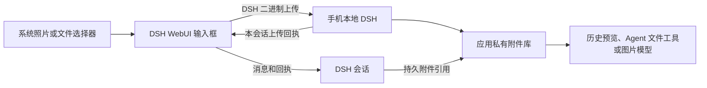

<!--
[INPUT]: 锁定的 DSH 0.2.2-rc.5 附件与会话契约、移动端 WebView 和存储接缝、Fish Pocket 与 DSH Go 的公开实现。
[OUTPUT]: 手机本地会话的附件方案、双端职责和分步验收标准。
[POS]: 手机附件设计提案。当前实现状态见 mobile-capabilities.md，平台边界见 architecture.md。
[PROTOCOL]: 变更时更新此头部，然后检查 CLAUDE.md
-->

# 手机本地会话附件设计

Android 本地会话可发送普通文件和图片。普通文件按原字节保存，Agent 可通过 DSH 文件工具读取。图片预览和模型请求使用持久附件引用。iOS 附件列为追平项。

PDF 和 Word 首期作为普通文件接收。文档内容提取、OCR、跨设备附件传输和 Remote Tools 分开规划。

## 两个参考项目

| 项目 | 源码中的实现 | OwnDsh 的取舍 |
| --- | --- | --- |
| Fish Pocket | 原生输入框接照片、相机和系统文件选择。选中的数据先放私有临时文件，再走 DSH 的二进制上传。普通文件和已暂存的图片都用上传回执关联到消息。引擎在附件库的 Sharp 调用处接入由 ImageIO 支撑的实现。 | 沿用先上传、后引用的 DSH 流程，参考图片编解码在引擎侧的接法。OwnDsh 直接复用 DSH WebUI 输入框。 |
| DSH Go | Flutter 用系统选择器读图片和文件。选图时缩放，读文件时按实际字节数限制。普通文件优先二进制上传并使用回执，图片通常随消息内联。部分旧 Host 或远程载体另有兼容路径。它的 iOS 版本也适配了 ImageIO。 | 借鉴按实际读入字节限额和明确区分上传失败、发送失败。图片与普通文件都使用当前锁定 DSH 的二进制上传流程。 |

Fish Pocket 源码固定在 `1d523f1`。[输入框](https://github.com/imsai-sh/fish-pocket/blob/1d523f1ae1169f776db63bc00e459f89e0d6c598/app/DshIOS/Views/ComposerView.swift) · [上传与回执](https://github.com/imsai-sh/fish-pocket/blob/1d523f1ae1169f776db63bc00e459f89e0d6c598/app/DshIOS/Models/ComposerModel.swift) · [ImageIO 适配](https://github.com/imsai-sh/fish-pocket/blob/1d523f1ae1169f776db63bc00e459f89e0d6c598/engine/shims/sharp.mjs)

DSH Go 源码固定在 `20c95cc`。[选择与限额](https://github.com/ccch1mneyyy/dsh-Go/blob/20c95cc8badc3a97640de941b0d4b951cffff5a4/app/lib/state/attachments.dart) · [发送流程](https://github.com/ccch1mneyyy/dsh-Go/blob/20c95cc8badc3a97640de941b0d4b951cffff5a4/app/lib/state/chat_state.dart) · [二进制上传](https://github.com/ccch1mneyyy/dsh-Go/blob/20c95cc8badc3a97640de941b0d4b951cffff5a4/packages/dsh_client/lib/src/session_api.dart) · [iOS 图片适配](https://github.com/ccch1mneyyy/dsh-Go/blob/20c95cc8badc3a97640de941b0d4b951cffff5a4/runtime/ios/image/ios-sharp.cjs)

OwnDsh 自行实现平台适配。Fish Pocket 的 MIT 文本后附商用和公开发布改造版条款，DSH Go 仓库采用 AGPL-3.0。设计参考来自上述源码，实际复用的附件业务代码来自 DSH 官方包。[Fish Pocket 许可证](https://github.com/imsai-sh/fish-pocket/blob/1d523f1ae1169f776db63bc00e459f89e0d6c598/LICENSE) · [DSH Go 许可证](https://github.com/ccch1mneyyy/dsh-Go/blob/20c95cc8badc3a97640de941b0d4b951cffff5a4/LICENSE)

## 复用官方附件流程

Android 宿主通过 `native.imageCodecPath` 启用 DSH 附件界面、存储和 `read_image`。输入框保留官方权限判断，附件入口限于本地会话。iOS 目前采用纯文本实现。[手机 profile](engine/mobile.patch.yml) · [Android 附件实现](engine/android-attachments.mjs) · [构建适配](scripts/prepare-engine.mjs)

DSH WebUI 负责草稿、预览、进度、移除和上传失败提示。已有会话可用官方 `POST /api/session/uploadFileBinary`，携带会话 ID 和文件名，图片另带媒体类型。DSH 持久化附件并签发会话专属回执。DSH 也支持首条消息内联图片，先完成附件持久化，再写入会话。历史统一保存附件引用。原生层交付系统选择结果。

普通文件沿用 DSH 的文件引用和路径映射。首期用文本文件验证 Agent 能通过已有只读文件工具读取实际内容。PDF 和 DOCX 用于验证原字节存储以及历史回读。

## 平台职责

| 位置 | 职责 |
| --- | --- |
| Android 宿主 | 在 `WebChromeClient.onShowFileChooser` 响应可信工作区的文件选择。普通文件和图片都用现有 SAF，临时授权 URI 交给原输入框。取消、页面替换和引擎换代时结束旧请求。 |
| iOS 宿主 | 优先用 WKWebView 原生的 HTML 文件选择，覆盖 iOS 15 基线。系统有自定义上传面板回调时再按需接入，回调自 iOS 18.4 可用。处理系统提供方临时访问的生命周期。 |
| 共享引擎与构建 | 挂载官方 DSH 附件存储和会话服务。Android 通过 Node-API 后台工作调用系统 ImageDecoder 与 Bitmap。iOS 编解码待接入，优先验证 ImageIO。 |

首期以选取已有照片和文件为主。若系统选择器同时提供相机入口，由设备验证记录实际行为。独立拍照按钮可以在后续按需求接入。

## 存储与图片编解码

在两个候选方案中，优先保留官方 `LocalAttachmentStore`，仅在文件发布与图片处理的接缝做适配。其余规则由 DSH 继续负责，包括内容摘要、引用、文件名、落盘、历史读取和模型请求。另一个方案是实现新的 `AttachmentStore`。后者需要承担原字节文件流、去重、持久引用、图片回读和请求变体的一致性，重复面更大。前端 Canvas 可减少传入图片的体积，但 DSH 在验证、回读和构建模型请求时还会处理图片。

**文件发布。** iOS 待接入时优先验证原有 `link`。Android 使用现有的 `renameat2(RENAME_NOREPLACE)` 发布同卷暂存文件。别名从正式对象流式复制到独立暂存文件并校验摘要，再排他发布。目标已存在时验证已有字节的摘要。目录逐级同步到系统创建的私有 `files` 目录，Android 会拒绝附件库打开更高层的系统目录。[现有发布接口](engine/native-storage.mjs) · [DSH Go 的存储兼容参考](https://github.com/ccch1mneyyy/dsh-Go/blob/20c95cc8badc3a97640de941b0d4b951cffff5a4/runtime/patches/attachment-link-fallback.diff)

**图片处理。** 桌面和 Android 都锁定 DSH 0.2.2-rc.5，复用附件准入、持久引用、历史预览、模型请求预算和 `read_image`。桌面用 Sharp。Android 使用系统解码器，在分配位图前检查真实格式、长边和像素数，读取首帧并按 EXIF 方向转为 sRGB。输入支持 JPEG、PNG、WebP 和 GIF。归一化重新编码，去除原始 EXIF 等元数据。有透明度时输出 WebP，否则输出 JPEG。Sharp 可按其条件保留原始图片。Android 编码结果的字节可能不同，因此使用独立的模型变体缓存版本。

`inspect(bytes, maxPixels, maxDimension)` 返回格式、方向校正后的宽高和透明通道。它会完整解码所使用的首帧。 `encode(bytes, width, height, mediaType, quality)` 返回目标尺寸的编码字节。两者由同一 `libowndsh_node.so` 提供。构建准备器校验 DSH 附件库的完整哈希，并在图片检查、归一化和模型变体生成处接入原生绑定。

## 限额、取消和会话归属

Android 单张图片和单个普通文件上限均为 20 MiB。每条消息最多 4 张图，源图片合计 32 MiB。解码上限为 2400 万像素和单边 16384 像素。普通文件按实际字节计数。图片限额通过 DSH 的 `imageLimits` 投影到输入框，模型请求继续使用路由预算。

选择器、上传和发送都绑定发起时的页面、会话和引擎。切换会话后旧草稿仍归原会话。页面失效后迟到的选择结果直接丢弃。用户移除附件时终止在途上传。若 DSH 已完成对象落盘，按上游保留规则处理，因为同一对象可能被其他消息引用。重启后的旧草稿重新选取或上传，已发送消息通过持久引用回读。

本地上传沿用已认证的回环入口。远程工作区以远端 Host 的访问权限和原上传链路为准，设备能力与远端权限分别判定。远程授权以后独立验证从手机上传到指定 Host 的完整路径。

## 验收

1. **Android 普通文件。** Android 15 模拟器通过系统选择器发送 TXT、PDF 和 DOCX。文本由 DSH 原生 `read` 工具读取。文件历史和附件库保留可回读引用及原字节。
2. **Android 图片。** Android 15 模拟器通过会话首条消息、有回执的上传、模型请求、重启预览和工作区 `read_image` 验收。同一组 EXIF 旋转 JPEG、透明 PNG 和动图 GIF 通过桌面 Sharp 对照。另验证超模型预算时重新编码，以及截断和像素超限输入被拒绝。
3. **iOS 追平。** 在 iOS 15 基线验证 WKWebView 选择、临时授权、原字节文件历史回读，接入图片编解码后复用 Android 的图片样本。

[PROTOCOL]: 变更时更新此头部，然后检查 CLAUDE.md
